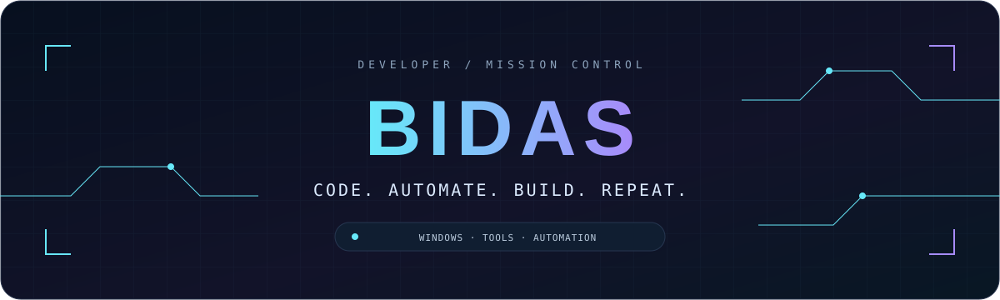
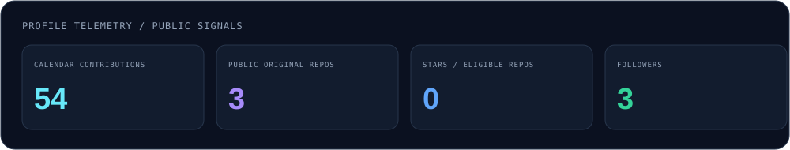
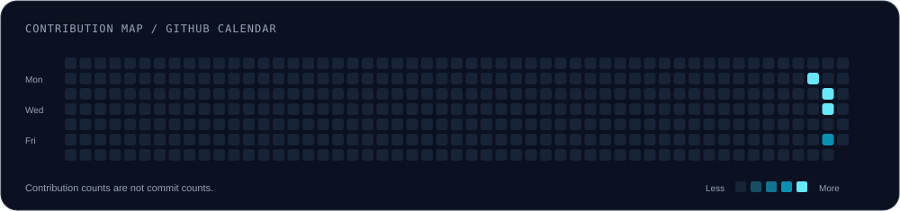
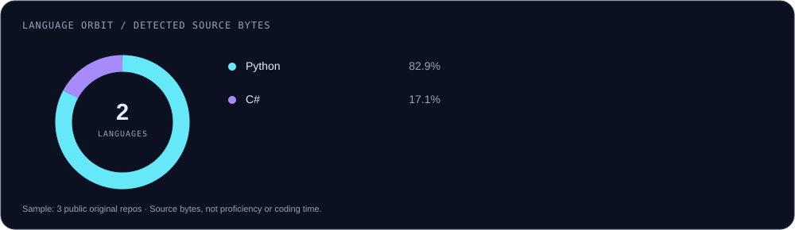
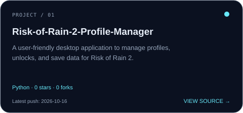
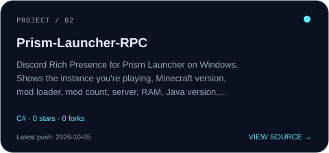

<!-- BIDAS / MISSION CONTROL — generated sections are updated by scripts/update_profile.py -->

  

  
  
  
  

  <samp>Final Packet Makers / WINDOWS TOOLS &amp; AUTOMATION</samp> 
  Practical projects. A little less friction, a lot more possibility.

---

## 🧭 The person behind the code

I'm an independent developer behind the **Final Packet Makers** Group.
I build Windows tools and automation — from system utilities to Discord bots —
and I like software that is clear, fast and genuinely useful.

- ⚙️ Windows utilities, system tools and automation scripts.
- 🤖 Discord bots with JavaScript and discord.js v14.
- 🎮 Game-related tools and overlays.
- 🧪 Prototypes, real debugging sessions and constant iteration.

> Build something useful. Make it clear. Make it faster. Keep iterating.

## 🤖 Bring the bot to your server

   
  Open Discord's authorization page to review the installation options and requested permissions.

## 🧬 Technology arsenal

  &nbsp;&nbsp;
  &nbsp;&nbsp;
  &nbsp;&nbsp;
  &nbsp;&nbsp;
  &nbsp;&nbsp;
  &nbsp;&nbsp;
  &nbsp;&nbsp;
  &nbsp;&nbsp;
  &nbsp;&nbsp;
  &nbsp;&nbsp;
  &nbsp;&nbsp;
  &nbsp;&nbsp;
  

<samp>JavaScript · HTML · CSS · C# · Java · Python · C++ · C · SQL · Batch / Terminal · Visual Studio · VS Code · Zed</samp>

⚙️ What I like building with them

 

| Area | Tools |
| :--- | :--- |
| Bots & automation | JavaScript · Node.js · discord.js v14 |
| Web interfaces | HTML · CSS · JavaScript |
| Desktop apps | C# / WPF / .NET · Java · Python (PySide6, PyQt6, CustomTkinter) |
| Data & storage | SQL |
| Low-level Windows | C++ (Win32 / GDI) · C |
| Scripting & terminal | Batch (.bat) · Terminal |
| Editors & IDEs | Visual Studio · Visual Studio Code · Zed |

These are the technologies I use or study.

## 📡 Live telemetry

<picture>
  <source media="(prefers-color-scheme: dark)" srcset="assets/dashboard-dark.svg" />
  <source media="(prefers-color-scheme: light)" srcset="assets/dashboard.svg" />
  
</picture>

<!-- SNAPSHOT:START -->
Last successful sync: 2026-10-31 UTC · Contribution period: 2025-10-26 → 2026-10-31 · Projects ordered by latest push.
<!-- SNAPSHOT:END -->

<picture>
  <source media="(prefers-color-scheme: dark)" srcset="assets/contributions-dark.svg" />
  <source media="(prefers-color-scheme: light)" srcset="assets/contributions.svg" />
  
</picture>

<picture>
  <source media="(prefers-color-scheme: dark)" srcset="assets/languages-dark.svg" />
  <source media="(prefers-color-scheme: light)" srcset="assets/languages.svg" />
  
</picture>

🔎 How these numbers are calculated

 

- Contributions come from GitHub's contribution calendar API. Contributions are not the same as commits.
- The project selection includes public, original, non-archived repositories and excludes this profile repository.
- Stars in the dashboard are summed across my own eligible repositories; community project stars are shown separately.
- Language percentages use GitHub's detected source bytes across up to 40 eligible repositories, ordered by recent push date. They do not measure skill or time spent coding.
- Community projects are selected from detected public participation, ranked by their stars and forks, and linked to evidence.
- Recent activity comes from the public events feed; it is a selection, not a complete commit history.
- Dashboard images live in this repository. No external statistics-card server is needed.

## 🚀 Personal projects

Public projects, refreshed automatically. Start with the source — then make it your own.

<!-- PROJECTS:START -->
<table>
<tr>
<td width="50%"><a href="https://github.com/BidasFPM/Risk-of-Rain-2-Profile-Manager"><picture><source media="(prefers-color-scheme: dark)" srcset="assets/project-1-dark.svg" /><source media="(prefers-color-scheme: light)" srcset="assets/project-1.svg" /></picture></a></td>
<td width="50%"><a href="https://github.com/BidasFPM/Prism-Launcher-RPC"><picture><source media="(prefers-color-scheme: dark)" srcset="assets/project-2-dark.svg" /><source media="(prefers-color-scheme: light)" srcset="assets/project-2.svg" /></picture></a></td>
</tr>
<tr>
<td width="50%"><a href="https://github.com/BidasFPM/R.E.P.O-Cosmetic-Unlocker"><picture><source media="(prefers-color-scheme: dark)" srcset="assets/project-3-dark.svg" /><source media="(prefers-color-scheme: light)" srcset="assets/project-3.svg" /></picture></a></td>
<td></td>
</tr>
</table>
<!-- PROJECTS:END -->

  <a href="https://github.com/BidasFPM?tab=repositories">Explore all public repositories →</a>

## 🌍 Beyond my own repositories

Projects by other maintainers where public GitHub activity shows my participation.
Featured projects are ranked by stars, then forks — popularity belongs to the project, not to my contribution.

<!-- COMMUNITY:START -->
Community participation appears here after the first profile sync.
<!-- COMMUNITY:END -->

🔎 What counts as participation?

 

- Merged pull request: an authored proposal that was integrated.
- Open / closed unmerged pull request: an authored proposal, not integrated code.
- Authored commit: code attributed to my account on a repository's default branch.
- Opened issue: a report or proposal, not necessarily a code contribution.
- Review / discussion: code review or comments, not ownership of the project.
- Every featured card includes links to the matching public evidence.
- Stars, follows, mentions and creating a fork alone do not qualify.
- Search is bounded and may miss unindexed activity, unlinked commit emails or non-default branches.
- Optional repository candidates in `profile-config.json` are checked for evidence; adding a name does not claim participation.

## ⚡ Development log

<!-- ACTIVITY:START -->
- `2026-10-16` · Pushed code to [BidasFPM/Risk-of-Rain-2-Profile-Manager](https://github.com/BidasFPM/Risk-of-Rain-2-Profile-Manager)
- `2026-10-16` · Published release [RiskofRain2ProfileManager](https://github.com/BidasFPM/Risk-of-Rain-2-Profile-Manager/releases/tag/RiskofRain2ProfileManager)
- `2026-10-13` · Pushed code to [D4rkpt/AutoLauncher-for-PaperMC](https://github.com/D4rkpt/AutoLauncher-for-PaperMC)
- `2026-10-05` · Pushed code to [BidasFPM/Prism-Launcher-RPC](https://github.com/BidasFPM/Prism-Launcher-RPC)
- `2026-10-05` · Published release [PrismLauncherRPC](https://github.com/BidasFPM/Prism-Launcher-RPC/releases/tag/PrismLauncherRPC)
- `2026-10-05` · Created branch `main` in [BidasFPM/Prism-Launcher-RPC](https://github.com/BidasFPM/Prism-Launcher-RPC)
<!-- ACTIVITY:END -->

## 👾 Commit arcade

Your contributions. An alien formation. One relentless ship.

<samp>WRITE CODE → BUILD THE GRID → WATCH THE INVASION</samp>

<picture>
  <source media="(prefers-color-scheme: dark)" srcset="https://raw.githubusercontent.com/BidasFPM/BidasFPM/output/commit-invaders-dark.svg" />
  <source media="(prefers-color-scheme: light)" srcset="https://raw.githubusercontent.com/BidasFPM/BidasFPM/output/commit-invaders.svg" />
  
</picture>

  An animated contribution visualisation — not a keyboard-playable game inside GitHub. 
  <a href="https://goblinlordx.github.io/commit-invaders/">Open the interactive animation demo ↗</a>

🛠️ Want this arcade on your own profile?

 

The animation is powered by [Goblinlordx/commit-invaders](https://github.com/Goblinlordx/commit-invaders).
The ready-to-use workflow is in [`.github/workflows/commit-invaders.yml`](.github/workflows/commit-invaders.yml).
It uses the repository owner's username automatically and generates light and dark variants.

---

  <samp>LESS REPETITION. MORE CREATION.</samp> 
  Built with curiosity · Updated with GitHub Actions · Final Packet Makers

